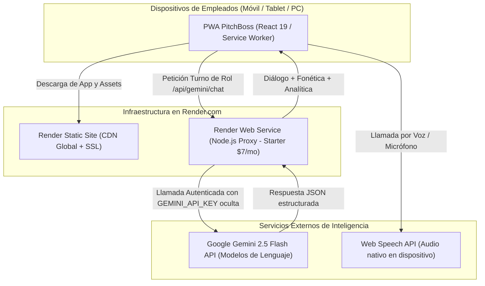

# PitchBoss Enterprise — Informe de Infraestructura de Servidores y Costes en Render
> **Destinatarios:** Equipo Fundador, Dirección Técnica y Socios  
> **Proveedor Cloud:** [Render.com](https://dashboard.render.com/)  
> **Fecha:** Octubre 2026 | **Versión:** 1.0 Producción  

---

## 1. Resumen Ejecutivo de Infraestructura

PitchBoss ha sido concebido bajo una **arquitectura de software ultra-eficiente (Lean Architecture)**. A diferencia de las plataformas tradicionales de Inteligencia Artificial que requieren costosas GPUs dedicadas o servidores de miles de dólares al mes, PitchBoss combina:
1. **Frontend PWA de alto rendimiento:** Compilado como aplicación web progresiva estática (Vite + React 19 + Tailwind CSS) servida a través de la red CDN global de Render.
2. **Backend Proxy Node.js de micro-huella:** Un micro-servicio ligero (`server/proxy.mjs`) que actúa como pasarela de seguridad para ocultar la clave maestra de Google Gemini, validar licencias de empresas y prevenir abusos sin almacenar datos sensibles.
3. **Cerebro Cognitivo Serverless:** Motor de inferencia en tiempo real apoyado en Google Gemini 2.5 Flash / Flash-Lite mediante API REST con llamadas estructuradas en formato JSON estricto.
4. **Motor de Voz en el Cliente:** Síntesis y reconocimiento de voz (STT y TTS) ejecutados directamente en el navegador del usuario final a través de la Web Speech API nativa, con coste de servidor cero en audio streaming.

> [!NOTE]
> **Conclusión Clave de Coste:** El coste total de infraestructura en servidores para lanzar y operar PitchBoss con sus primeros clientes comerciales es de **aproximadamente 7,00 USD / mes (unos 6,50 €/mes)** en Render, con un coste marginal de Inteligencia Artificial de apenas **fracciones de céntimo por sesión**. El punto de equilibrio (*break-even*) se alcanza con el **primer cliente de pago**.

---

## 2. Comparativa de Planes y Arquitectura en Render.com

Render ofrece dos modelos de despliegue para nuestra solución:

### 2.1. Opción A: Despliegue 100% Estático (Render Static Site)
* **Tipo de servicio en Render:** `Static Site`
* **Coste mensual en Render:** **0,00 USD (GRATIS)**
* **Capacidades incluidas:**
  - Ancho de banda: 100 GB/mes incluidos.
  - Certificado SSL automático (HTTPS con renovación periódica sin coste).
  - Red CDN global con caché perimetral en Europa y América.
  - Despliegues continuos ilimitados vinculados a GitHub (`main` branch).
* **Limitaciones para producción B2B:**
  - Requiere que la API Key de Gemini resida en el almacenamiento local del cliente (`localStorage`) o se inserte en el build. En un entorno corporativo donde varios restaurantes usan la plataforma, no es recomendable exponer la clave de API en las herramientas de desarrollador (F12) del navegador.

---

### 2.2. Opción B (RECOMENDADA): Arquitectura B2B Segura (Static Site + Web Service Starter)
* **Tipo de servicio en Render:**
  1. `Static Site` para la PWA de usuario ($0.00/mes).
  2. `Web Service` (Node.js) ejecutando `server/proxy.mjs` como Backend Proxy ($7.00/mes).
* **Coste mensual en Render:** **7,00 USD / mes (aprox. 6,50 €/mes)**

#### ¿Por qué el plan Starter ($7/mes) y no el Free ($0/mes) para el Web Service?
* **El problema del Plan Free en Web Services:** Render duerme (*spin-down*) los servicios gratuitos después de **15 minutos de inactividad**. Cuando un camarero entra a practicar, el servidor tarda entre **45 y 55 segundos en despertar** (*cold start*). Esto arruina por completo la experiencia de usuario en hostelería.
* **Las ventajas del Plan Starter ($7/mes):**
  - **Always-On 24/7/365:** El servidor nunca se duerme. Tiempo de respuesta inmediato (< 200 ms).
  - **Recursos dedicados:** 512 MB RAM y 0.5 CPU virtual. Nuestro proxy en Node.js apenas consume ~45 MB de RAM, lo que le permite atender holgadamente a más de 1.000 peticiones simultáneas sin inmutarse.
  - **Protección estricta de Secretos:** La variable de entorno `GEMINI_API_KEY` se configura en el panel privado de Render y nunca viaja al navegador de los camareros.
  - **Métricas y Alertas:** Gráficas de uso de CPU, memoria y alertas automáticas por correo en caso de degradación del servicio.

---

## 3. Estimación Detallada de Costes de Inteligencia Artificial (Google Gemini)

El consumo de IA se factura exclusivamente por volumen de texto procesado (*tokens* de entrada y salida):

| Concepto | Tarifa Oficial Google Gemini 2.5 Flash |
| :--- | :--- |
| **Tokens de Entrada (Prompt + Menú + Contexto)** | **$0,075 USD por cada 1.000.000 tokens** |
| **Tokens de Salida (Respuesta + Fonética + Corrección)** | **$0,300 USD por cada 1.000.000 tokens** |

### 3.1. Cálculo de Consumo por Sesión de Entrenamiento
* 1 sesión de entrenamiento típica = 10 turnos de conversación de rol (unos 4-5 minutos).
* Contexto inyectado en cada turno (carta, protocolos, historial reciente): ~500 tokens de entrada.
* Respuesta generada por la IA (frase en inglés, traducción, consejo fonético): ~120 tokens de salida.
* **Consumo por turno:**
  - Entrada: $500 \times \frac{\$0,075}{1.000.000} = \$0,0000375$
  - Salida: $120 \times \frac{\$0,300}{1.000.000} = \$0,0000360$
  - Total por turno: **$0,0000735 USD**
* **Coste de 1 sesión completa de 10 turnos:**
  $$\text{Coste por sesión} = 10 \times \$0,0000735 = \mathbf{\$0,000735\text{ USD (menos de 0,08 céntimos de euro)}}$$

### 3.2. Proyección de Costes de IA según Volumen de Clientes

| Escala de Negocio | Empleados Activos | Sesiones Mensuales | Tokens Totales / Mes | Coste Mensual de IA (Gemini) |
| :--- | :---: | :---: | :---: | :---: |
| **Fase Piloto (3 clientes)** | 15 camareros | 300 sesiones | ~1,8 Millones | **0,35 USD / mes** |
| **Fase Lanzamiento (15 clientes)** | 75 camareros | 1.500 sesiones | ~9 Millones | **1,75 USD / mes** |
| **Fase Expansión (50 clientes)** | 300 camareros | 6.000 sesiones | ~36 Millones | **7,00 USD / mes** |
| **Fase Consolidación (200 clientes)** | 1.200 camareros | 24.000 sesiones | ~144 Millones | **28,00 USD / mes** |

> [!TIP]
> Incluso con 200 restaurantes y hoteles entrenando a más de 1.200 empleados cada mes, el coste total de la inteligencia artificial de Google es inferior a **30 USD al mes**.

---

## 4. Costes Adicionales (Dominio, SSL y Correo)

| Elemento | Proveedor Recomendado | Coste Anual | Coste Mensual Equivalente | Observaciones |
| :--- | :--- | :---: | :---: | :--- |
| **Dominio Comercial** (`.com`, `.es`, `.app`) | Cloudflare / Namecheap / GoDaddy | 12,00 € - 18,00 € | **~1,25 € / mes** | Permite usar `app.pitchboss.es` o `pitchboss.ai`. |
| **Certificado SSL / HTTPS** | Render (Let's Encrypt) | **0,00 €** | **0,00 €** | Renovación y emisión 100% automatizada. |
| **Red CDN y Mitigación DDoS** | Render Global Edge CDN | **0,00 €** | **0,00 €** | Incluido en la capa estándar de Render. |
| **Correo Corporativo** | Google Workspace o Zoho Mail | 12,00 € - 72,00 € | **~1,00 € - 6,00 € / mes** | Para comunicaciones comerciales (`hola@pitchboss.es`). |

---

## 5. Cuadro Resumen de Presupuesto Operativo por Fases

| Concepto de Gasto | Fase 1: Lanzamiento (1-10 Clientes) | Fase 2: Tracción (10-40 Clientes) | Fase 3: Escala (50-150 Clientes) |
| :--- | :---: | :---: | :---: |
| **Servidor Render (Starter Web Service)** | 7,00 $ (~6,50 €) | 7,00 $ (~6,50 €) | 25,00 $ (~23,00 €) *(Standard)* |
| **Render Static CDN (PWA Frontend)** | 0,00 $ (Gratis) | 0,00 $ (Gratis) | 0,00 $ (Gratis) |
| **Consumo API Google Gemini** | 1,50 $ (~1,40 €) | 5,50 $ (~5,00 €) | 20,00 $ (~18,50 €) |
| **Dominio y DNS** | 1,25 € | 1,25 € | 1,25 € |
| **Total Coste Operativo Mensual** | **~9,15 € / mes** | **~13,95 € / mes** | **~42,75 € / mes** |
| **Ingresos Estimados (Precio medio 99€/mes)** | **495 € - 990 € / mes** | **1.980 € - 3.960 € / mes** | **4.950 € - 14.850 € / mes** |
| **Margen Operativo Bruto** | **> 98,5 %** | **> 99,4 %** | **> 99,6 %** |

---

## 6. Procedimiento Paso a Paso para Desplegar en Render.com

Para dejar el servidor en producción comercial definitivo, se siguen estos 4 sencillos pasos en [dashboard.render.com](https://dashboard.render.com/):

### Paso 1: Conectar el Repositorio de GitHub
1. Iniciar sesión en [dashboard.render.com](https://dashboard.render.com/).
2. Pulsar en **New +** > **Web Service** (o Blueprint si usamos `render.yaml`).
3. Seleccionar el repositorio: `snake33madb2017/PitchBoss`.

### Paso 2: Configurar las Variables de Entorno Seguras
En la pestaña **Environment**:
* `NODE_VERSION`: `20.11.0` (o superior)
* `PORT`: `3001` (o el puerto asignado por Render)
* `GEMINI_API_KEY`: *(Tu clave privada de Google AI Studio / Google Cloud Vertex)*

### Paso 3: Configurar Comandos de Ejecución
* **Build Command:** `npm install && npm run build`
* **Start Command:** `node server/proxy.mjs`
* **Instance Type:** `Starter` (7$/mes, con facturación prorrateada al segundo).

### Paso 4: Vincular Dominio Propio
1. En la pestaña **Settings** > **Custom Domains**, escribir `app.tudominio.com`.
2. Añadir los 2 registros CNAME/A en el proveedor de DNS (Cloudflare, GoDaddy o DonDominio).
3. Render valida el dominio y emite el certificado SSL en menos de 3 minutos de forma automática.

---

## 7. Dictamen Técnico y Recomendación Final

> [!IMPORTANT]
> **Recomendación para los Socios:**
> 1. Iniciar la comercialización inmediata activando el plan **Starter de Render ($7/mes)**. La inversión es tan reducida que con un solo cliente pagando una mensualidad estándar (79 € o 149 €/mes), la infraestructura queda cubierta para todo el año.
> 2. Mantener la arquitectura serverless actual con Gemini 2.5 Flash, que garantiza respuestas en menos de 800 milisegundos con una precisión fonética excepcional y sin costes ocultos de mantenimiento.
