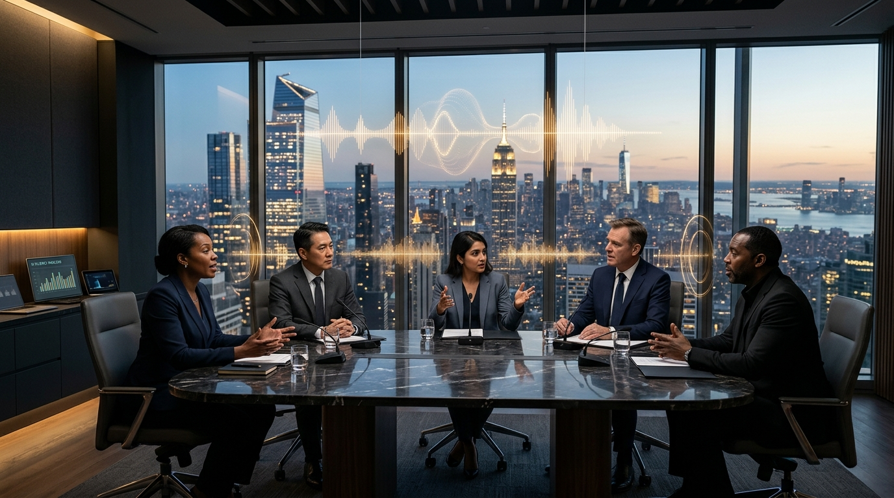

# PitchBoss Enterprise — Presentación Corporativa
> **Plataforma de Simulación por Voz con Inteligencia Artificial para el Dominio del Inglés Corporativo y Cierre de Negocios**

---

## Diapositiva 1: Portada Ejecutiva



### PitchBoss Enterprise: Fluidez Ejecutiva por Voz con IA

* **Propósito:** Transformar la seguridad y capacidad de comunicación en inglés de equipos corporativos y comerciales.
* **Modelo:** Simulador conversacional de voz de alta fidelidad basado en Inteligencia Artificial Generativa.
* **Impacto:** Eliminación inmediata del bloqueo lingüístico, mayor autoridad en reuniones internacionales y cierre efectivo de acuerdos.
* **Acceso:** Despliegue PWA instantáneo en el móvil de cada colaborador, sin fricción de tiendas de aplicaciones.

---

## Diapositiva 2: El Desafío — El Coste Oculto de la Vacilación en Inglés

> **En entornos corporativos globales, el 70% de las oportunidades comerciales o acuerdos clave se debilitan no por falta de capacidad técnica, sino por inseguridad y vacilación al defender ideas en inglés.**

### Factores Críticos en Empresas:
1. **La Paradoja de los Cursos Tradicionales:** Los colaboradores conocen la gramática teórica, pero carecen de horas de vuelo conversacional bajo presión.
2. **Coste de Tiempo de la Formación Convencional:** Clases de 2 horas a la semana desalineadas de las prioridades del negocio.
3. **Falta de Adaptación al Negocio:** Las academias no enseñan las objeciones, contratos, terminología y dinámicas de su sector.

---

## Diapositiva 3: La Solución — Entrenamiento por Voz en Situaciones Reales de Negocio


### ¿Cómo opera PitchBoss Enterprise?
* **Simulaciones de Voz Manos Libres:** El colaborador habla directamente con interlocutores de IA que adoptan personalidades ejecutivas (escépticos, directos, analíticos o colaborativos).
* **Entrenamiento Micro-Learning (5 a 10 min/día):** Sesiones rápidas antes de una llamada importante o durante desplazamientos.
* **Escenarios a la Medida de la Organización:** Configurables con los productos, objeciones y terminología exclusiva de la compañía.
* **Visualizador Reactivo:** Feedback acústico y háptico en tiempo real que emula una llamada telefónica o videoconferencia real.

---

## Diapositiva 4: Metodología de Alto Rendimiento en 4 Pasos

| Fase | Acción en PitchBoss | Resultado para el Colaborador |
| :--- | :--- | :--- |
| **1. Inmersión en Rol** | Apertura de llamada con contexto de negocio específico. | Superación del miedo escénico y adaptación inmediata al rol. |
| **2. Objeciones en Vivo** | La IA plantea contraargumentos sobre costes, tiempos o plazos. | Práctica de agilidad mental y argumentación convincente. |
| **3. Corrección Discreta** | Sugerencias ejecutivas y alternativas nativas en tiempo real. | Sustitución de expresiones literales por inglés de negocios nativo. |
| **4. Reporte Ejecutivo** | Evaluación de 0 a 100 en puntuación de negocio y fluidez. | Visibilidad inmediata de fortalezas y áreas prioritarias de mejora. |

> **Dato Clave:** Cada sesión analiza las frases del colaborador: *"Cómo lo dijiste"* vs. *"Cómo lo formularía un director nativo"*, acelerando la curva de aprendizaje en un 400% respecto a métodos convencionales.

---

## Diapositiva 5: Impacto Empresarial Medible y Retorno de Inversión (ROI)


### Beneficios Directos para la Organización:
* **Incremento en Tasa de Cierre:** Equipos comerciales seguros negociando márgenes y términos en inglés.
* **Excelencia en Soporte y Operaciones:** Reducción de malentendidos con clientes y socios estratégicos internacionales.
* **Alineación de Marca Global:** Imagen de alta solvencia corporativa en cualquier punto de contacto.
* **Retención y Desarrollo de Talento:** Capacitación práctica percibida como un beneficio de alto valor por los colaboradores.

---

## Diapositiva 6: Gobierno Corporativo y Despliegue Llave en Mano

```
┌────────────────────────────────────────────────────────┐
│             PORTAL DE ADMINISTRACIÓN EMPRESARIAL        │
│                                                        │
│  [✓] Gestión de Licencias Corporativas (30D, 90D, Anual) │
│  [✓] Repositorio de Escenarios Personalizados de Marca  │
│  [✓] Enlaces de Activación Mágica sin Contraseñas       │
│  [✓] Copias de Seguridad y Auditoría de Contenido      │
└────────────────────────────────────────────────────────┘
```

### Proceso de Implementación (En menos de 24 horas):
1. **Definición de Escenarios:** Configuración de las situaciones críticas de la empresa.
2. **Distribución Instantánea:** Envío de enlaces de activación a los dispositivos de los colaboradores.
3. **Medición Continua:** Seguimiento del progreso, horas de simulación y progreso de fluidez.

---
**PitchBoss Enterprise** — *Conversaciones de Negocio que Generan Resultados.*
